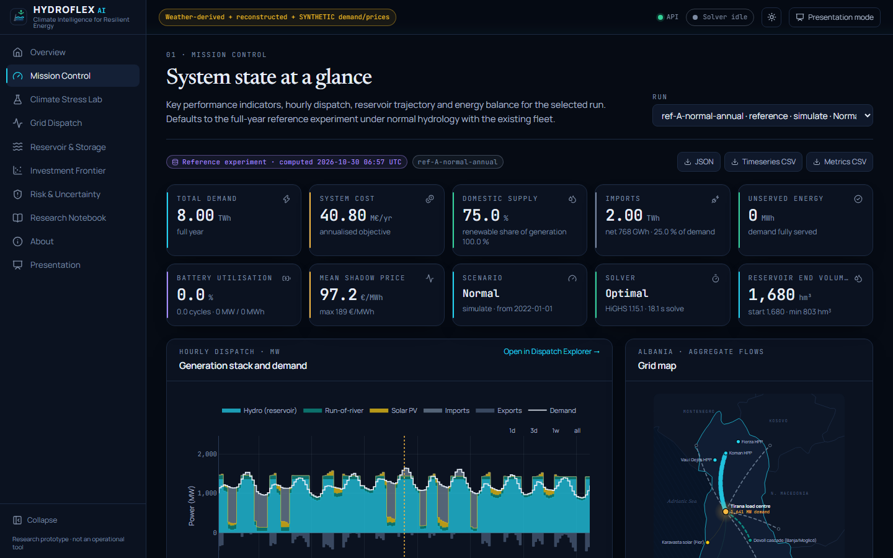
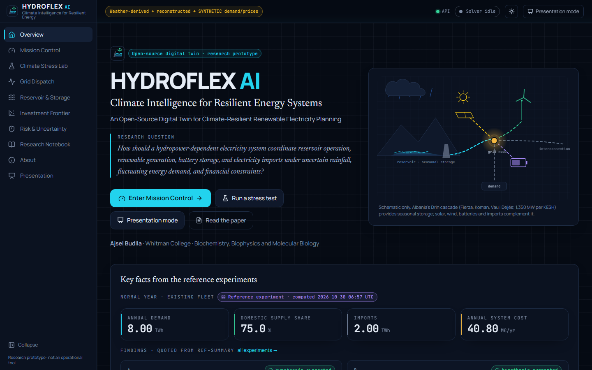
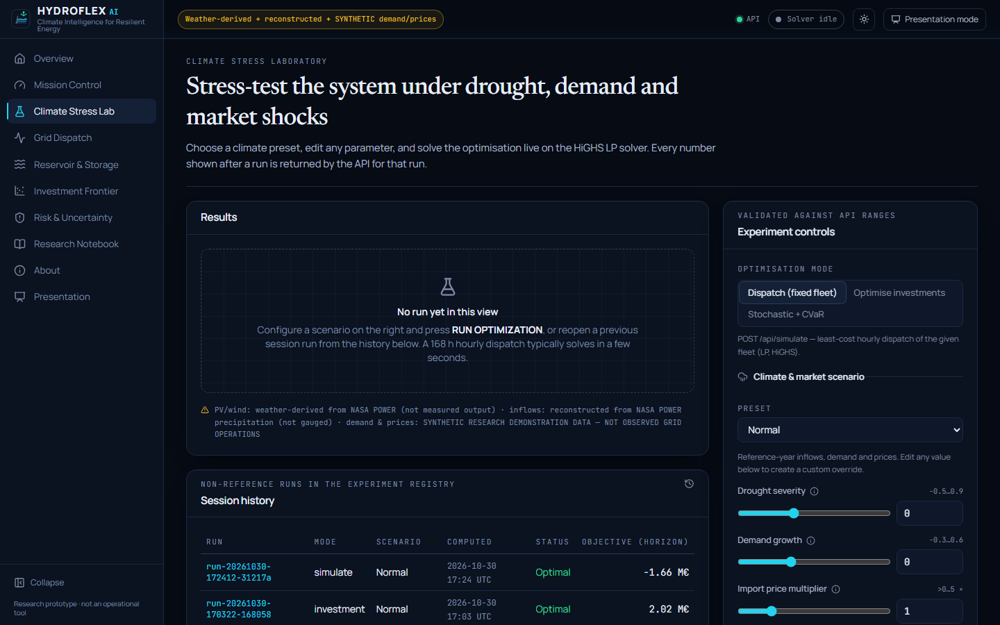
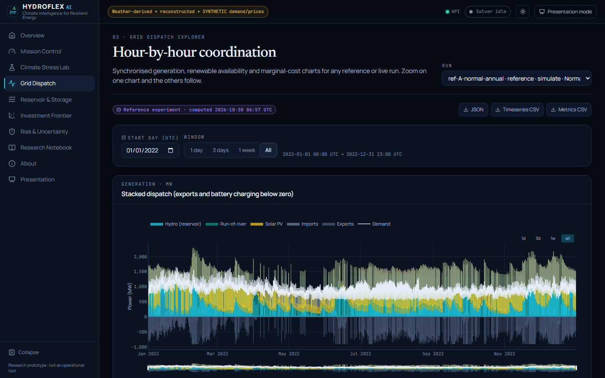
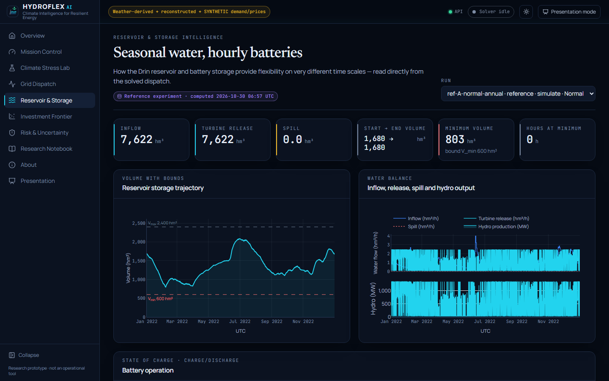
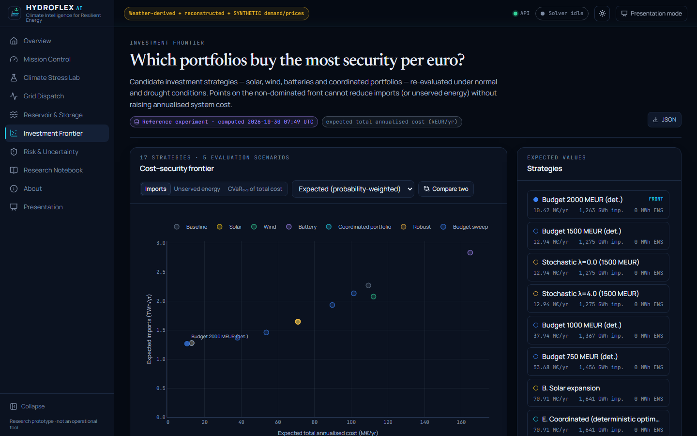
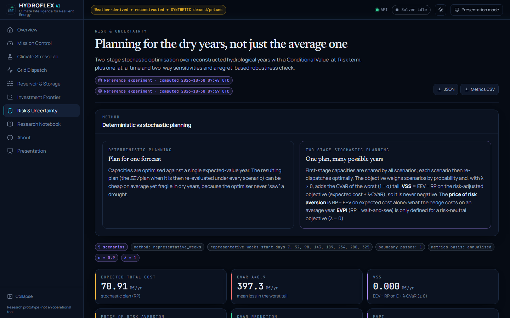
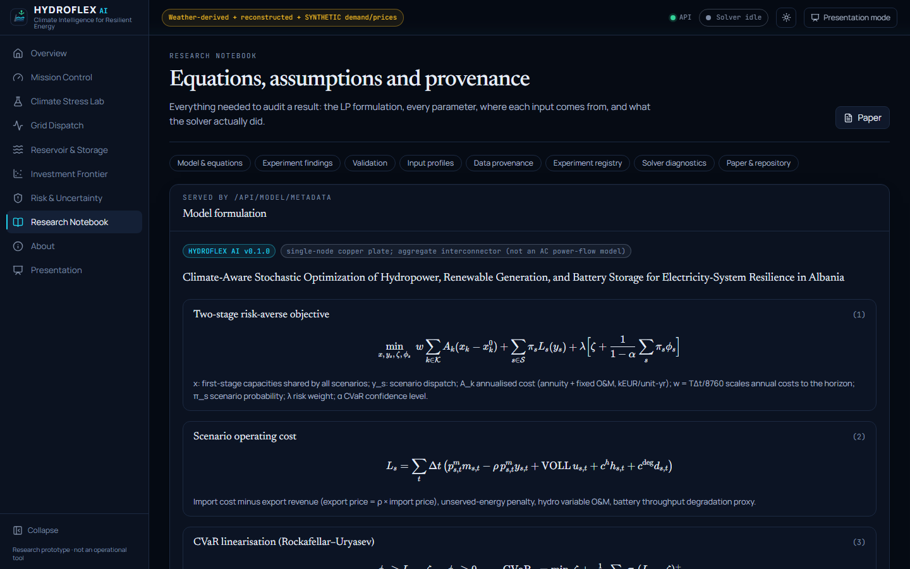
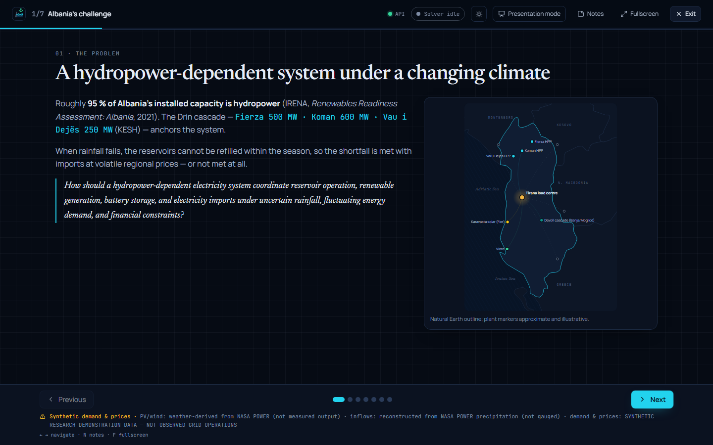

# HYDROFLEX AI

**Climate-Aware Stochastic Optimization of Hydropower, Renewable Generation, and Battery Storage for
Electricity-System Resilience in Albania**

*An Open-Source Digital Twin for Climate-Resilient Renewable Electricity Planning*

Ajsel Budlla · Whitman College · Biochemistry, Biophysics and Molecular Biology

> **Research prototype.** It is not an operational model and is not endorsed by IRENA, Whitman College or any
> Albanian grid operator or regulator. Demand and price inputs are **SYNTHETIC RESEARCH DEMONSTRATION DATA — NOT
> OBSERVED GRID OPERATIONS**. Inflows are reconstructed from reanalysis precipitation, and PV/wind availability
> is derived from weather data. The model is verified (tests, PyPSA cross-check) but **not validated against
> observed Albanian operations**.


| | |
|---|---|
| **Live website** (reference experiments + live HiGHS solver on Render) | https://hydroflex-ai.netlify.app |
| **Live solver API** | https://hydroflex-api.onrender.com/api/health |
| **Research paper (PDF, LaTeX via Tectonic, 30 pp.)** | [`research/paper/HydroFlex_AI_Research_Paper.pdf`](research/paper/HydroFlex_AI_Research_Paper.pdf) |
| **Poster (A0 PDF)** | [`research/poster/HydroFlex_AI_Poster.pdf`](research/poster/HydroFlex_AI_Poster.pdf) |
| **Demo video (MP4, 1:56, 1080p)** | [release v0.1.0](https://github.com/Ajsel28/hydroflex-ai/releases/tag/v0.1.0) · [online](https://hydroflex-ai.netlify.app/HydroFlex_AI_Demo.mp4) · captions [`video/HydroFlex_AI_Demo_Captions.srt`](video/HydroFlex_AI_Demo_Captions.srt) |
| **Executive summary / policy brief** | [`research/EXECUTIVE_SUMMARY.md`](research/EXECUTIVE_SUMMARY.md) · [`research/POLICY_BRIEF.md`](research/POLICY_BRIEF.md) |

The public website shows the verified reference experiments and runs **live HiGHS optimisations** on the Render
backend (free tier: limited problem sizes; the first request after idling wakes the instance in about a minute).



<details><summary>More screenshots</summary>

| | |
|---|---|
|  |  |
|  |  |
|  |  |
|  |  |

Mobile (390 px): `docs/screenshots/mobile/`.
</details>

---

## Research question
How should a hydropower-dependent electricity system coordinate reservoir operation, renewable generation,
battery storage and electricity imports under uncertain rainfall, fluctuating demand and financial constraints?

## What is in this repository
| Component | Path | Status |
|---|---|---|
| Optimisation engine (sparse LP → HiGHS): dispatch, reservoir water balance, battery, imports, investment, two-stage stochastic + CVaR | `packages/hydroflex/optimization/` | working, tested |
| Independent PyPSA/linopy implementation (cross-check) | `packages/hydroflex/optimization/pypsa_model.py` | agrees to solver precision |
| Data acquisition + provenance (NASA POWER, Open-Meteo, Natural Earth) | `packages/hydroflex/data/`, `data/provenance/` | 30 raw files retrieved (+ Natural Earth subset) |
| Climate / market scenarios | `packages/hydroflex/climate/scenarios.py` | 4 presets + 5-scenario stochastic set |
| Experiment pipeline A–K (+ sensitivity, resolution, validation) | `packages/hydroflex/experiments/` | executed; outputs in `results/experiments/` |
| FastAPI backend | `apps/api/hydroflex_api/` | working, 13 API tests |
| React/TypeScript digital-twin UI (10 pages incl. presentation mode) | `apps/web/` | builds; 42 unit tests + 3 Playwright e2e tests |
| LaTeX manuscript (sources, generated figures/tables) | `research/paper/` | compiled to PDF with Tectonic (XeTeX), 30 pages |
| Poster generator (A0 PDF) | `research/poster/` | generated with matplotlib |
| Policy brief (generated from results) | `research/POLICY_BRIEF.md` | generated |
| Demo video (rendered) + sources | `video/` | 1:56 MP4 built from real website captures (live HiGHS runs) and programmatic motion graphics; see `video/README.md` |

## Main findings (model implications under stated assumptions)
All numbers come from `results/experiments/` (regenerate with `python -m hydroflex.experiments.run_all`).

1. **Drought is a cost and import risk first.** Inflows −22% / −40% raise net imports from 0.77 to 2.26 / 3.48
   TWh/yr and operating cost from 40.8 to 192.7 / 324.5 MEUR/yr, with no unserved energy while the 900 MW
   interconnector is available.
2. **Interconnector availability governs reliability.** Under severe drought with +8% demand, shortage appears
   at ≤50% import availability (311 GWh/yr). It is energy-limited: a 400 MW / 1,600 MWh battery cuts it by only 13%,
   yet at VOLL 5,000 EUR/MWh that cut is worth 200 MEUR/yr, about 4× the battery's annualised cost.
3. **PV is a no-regret investment while its surplus can be exported.** Its marginal value is ≈140 kEUR/MW-yr
   against an 80 kEUR/MW-yr cost, and the deterministic optimum invests only in PV at every budget from 100 to
   2,000 MEUR. The technology choice is unchanged across a nine-parameter tornado analysis.
4. **Batteries don't pay through arbitrage** (savings 13–27% of annualised cost), and they *increase*
   gross imports. Extra discharge power is worth more than extra energy capacity.
5. **Stochastic planning (VSS) = 0 in the base case**: the risk-neutral and CVaR plans equal the deterministic
   plan. **With exports restricted to 300 MW**, CVaR planning adds wind: −74.5 MEUR/yr tail cost (CVaR₀.₉) for
   +15.1 MEUR/yr expected cost, confirmed with full-year chronology.
6. **Method matters.** 6-hourly steps remove 87% of battery value. Pinned representative-week boundaries
   created spurious scarcity (errors up to 20 MEUR/yr) that reversed a ranking; water-value boundaries reduce the
   error to 1.7–10 MEUR/yr with rankings preserved. Both failures and corrections are logged in
   `AUTONOMOUS_BUILD_LOG.md`.

## Architecture
```
NASA POWER / Open-Meteo / Natural Earth ─► data.fetch ─► data.profiles (PV, wind, inflow reconstruction,
                                                           synthetic demand & prices, provenance JSON)
                                         ─► climate.scenarios ─► optimization.model (sparse LP → HiGHS)
                                                                  ├─ runner (windows, nested & water-value boundaries,
                                                                  │          representative weeks)
                                                                  └─ pypsa_model (independent cross-check)
              analytics (explain, Pareto, regret) ◄─────────────────┘
experiments.run_all ─► results/experiments/*.json ─► figures / tables / summary / policy brief / poster
service ─► FastAPI (apps/api) ─► React UI (apps/web)
```

## Model (summary)
Minimise annualised investment + expected operating cost (imports − exports + VOLL·shortage + hydro O&M +
battery degradation) + λ·CVaR_α, subject to:
- the hourly energy balance;
- PV/wind availability (curtailment implicit);
- reservoir water balance `V(t+1) = V(t) + Δt (I − h/κ − spill)` with `κ = ρgHη ≈ 551.6 MWh/hm³`, bounds, minimum release and terminal conditions;
- battery SOC dynamics `e(t+1) = e(t) + Δt (η_c c − d/η_d)` with independent MW/MWh;
- import/export limits, the capital budget and maximum battery duration.

Full equations: `METHODOLOGY.md`, `docs/equations.json`, paper Section 4.

## Installation
```bash
python -m venv .venv
.venv/Scripts/activate            # Windows  (source .venv/bin/activate on Linux/macOS)
pip install -e ".[dev]"
cd apps/web && npm ci && cd ../..
```

## Run
```bash
# API (http://127.0.0.1:8000/docs)
python -m uvicorn hydroflex_api.main:app --port 8000
# Web UI (http://localhost:5173)
cd apps/web && npm run dev
```

## Data pipeline and experiments
```bash
python -m hydroflex.data.fetch            # download NASA POWER / Open-Meteo (no key needed)
python -m hydroflex.data.profiles         # build processed profiles + provenance
python -m hydroflex.experiments.run_all   # all experiments (≈1 h on 4 cores); --force to recompute, --only H,I2
python research/poster/make_poster.py     # poster
```
Outputs: `results/experiments/*.json` (machine-readable; `manifest.json` records versions and seeds),
`research/paper/figures/*.pdf|png`, `research/paper/tables/*.tex|csv`.

## Tests
```bash
pytest -q                                  # 67 Python tests (physics, conservation, CVaR, duals, PyPSA, API, data)
cd apps/web && npm run lint && npm run typecheck && npm test && npm run build && npm run test:e2e
```

## Paper
`research/paper/main.tex` (sections in `sections/`, bibliography `references.bib`, generated `figures/` and `tables/`).
Compiled PDF: `research/paper/HydroFlex_AI_Research_Paper.pdf`. To rebuild without installing a TeX distribution:
download the portable [Tectonic](https://tectonic-typesetting.github.io) binary and run `tectonic -X compile main.tex`
in `research/paper` (or use `latexmk -pdf main.tex` with TeX Live/MiKTeX).

## Deployment (live)
| Component | URL | Notes |
|---|---|---|
| Frontend | https://hydroflex-ai.netlify.app | Netlify. Reference experiments, metadata and provenance served as same-origin JSON snapshots produced by the real API (`scripts/build_static_site.py`). |
| Live solver API | https://hydroflex-api.onrender.com (`/api/health`) | Render free plan, Docker (`Dockerfile.api`, root `render.yaml`), auto-deploys from `main`. |

- The browser calls the Render API **directly** (CORS allows `https://hydroflex-ai.netlify.app`) for health, live
  optimisation runs and the run registry; reference artefacts (`ref-*`, `exp-*`) load from Netlify. Configured in
  `apps/web/.env.netlify` (`VITE_API_BASE=` same-origin, `VITE_LIVE_API_BASE=https://hydroflex-api.onrender.com`).
- Free-tier limits (set in `render.yaml`, reported by `/api/health` and applied by the Lab): 720 steps for dispatch
  and investment, 3,360 scenario-steps for stochastic runs (5 scenarios × 4 hourly weeks); 12 runs / 10 min per
  visitor. Full-year and 8-week stochastic studies are available as the verified reference experiments.
- The free instance sleeps when idle; the first request after a pause takes about a minute (the Lab shows this).
- Redeploy the frontend:
  `cd apps/web && npm run build:netlify && cd ../.. && python scripts/build_static_site.py && netlify deploy --prod --dir apps/web/dist`.
- Live runs are rate-limited and size-capped (`apps/api/hydroflex_api/main.py`).

## Documentation
`METHODOLOGY.md`, `MODEL_CARD.md`, `DATA_CARD.md`, `LIMITATIONS.md`, `docs/API_CONTRACT.md`, `docs/FRONTEND.md`,
`AUTONOMOUS_BUILD_LOG.md`, `FINAL_BUILD_REPORT.md`, `CHANGELOG.md`.

## Citation
```
Budlla, A. (2026). HYDROFLEX AI: Climate-aware stochastic optimization of hydropower, renewable generation,
and battery storage for electricity-system resilience in Albania (research prototype, v0.1.0).
```

## Licence
Code: MIT. Data: see the per-dataset licences in `data/provenance/` (NASA POWER acknowledgement; Open-Meteo CC BY 4.0;
Natural Earth public domain).
